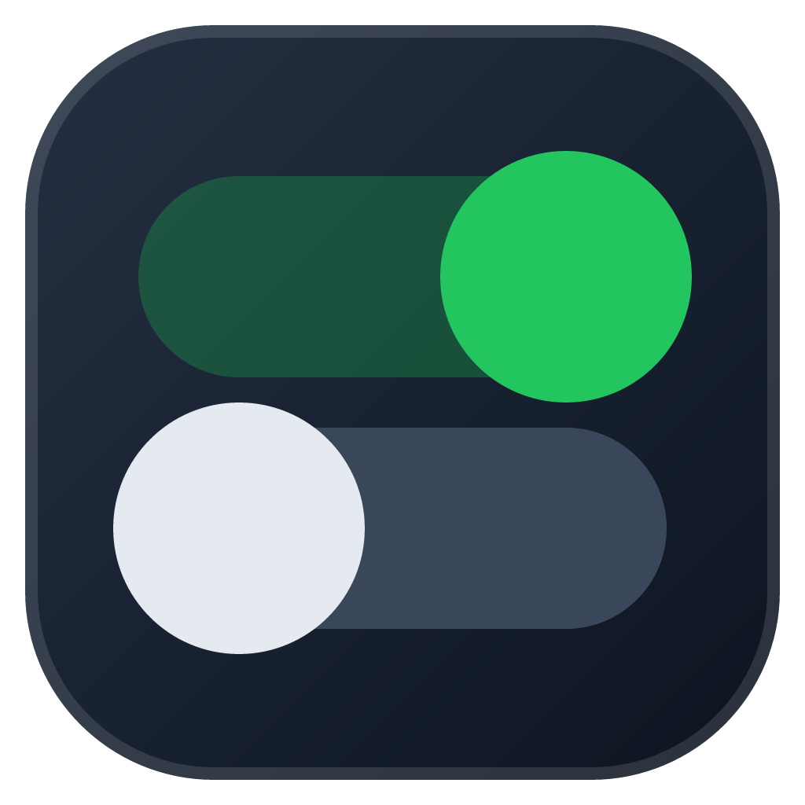

<p align="center">
  
</p>

<h1 align="center">Switchboard</h1>

<p align="center">A small Windows tray app for my PC utilities, built so new ones are easy to add.</p>

---

Switchboard lives in the tray. Left click opens a quick panel with a button for every action, right click gives a menu, and every action can also have a global hotkey or be run from the command line. It's built with Tauri 2 (Rust) and Svelte, the exe is about 4 MB, and it idles at around 18 MB because its windows are only created while they're open.

## Features

### Xbox mode
Puts an Xbox on a monitor shared with the PC whenever it's on, and gives the monitor back when it's off.

- **Xbox mode** means the Xbox is on and on screen. Turn the Xbox on however you like and the monitor switches over: its input changes over DDC/CI and Windows stops using it, so everything moves to your other screens. Pressing Xbox mode while the Xbox is off turns it on first and switches once it's up, so you're never looking at a blank input.
- **PC mode** brings the monitor back, and turning the Xbox off gets you there a few seconds later. It can also turn the Xbox off for you.
- Remembers which input the PC was on and notices Win+P changes. The Xbox is noticed on the local network. Signing in is optional and only needed to turn the Xbox on and off, which goes through Xbox Live like the Xbox app does, so it also needs Remote features on and the Xbox's power mode set to Sleep.

### Xbox presence
Shows what you're playing on Xbox in your Discord status.

- Works on its own, without Xbox mode. It checks every 15 seconds by itself (unless you turn off Check without Xbox mode), or every 5 seconds and only while the Xbox is on when Xbox mode is also on with a console chosen.
- Talks to the Discord client directly over its local pipe, so there's nothing else to install.

### Xbox captures
Copies new Xbox screenshots and recordings to the clipboard, so you can paste them straight into Discord.

- Take one on the console and it uploads to Xbox network. Switchboard notices (every 10 seconds while the Xbox is on, every 30 without Xbox mode unless you turn off Check without Xbox mode, and for two minutes after the Xbox turns off), downloads it (screenshots to Pictures\Xbox and recordings to Videos\Xbox by default) and copies it like Win+PrtScn does. Screenshots paste as images, recordings as files, and a toast says what happened.
- Captures already there when you turn it on are not treated as new. **Copy latest capture** grabs the newest one on demand, and **Open screenshots folder** opens where they go.
- Needs **Automatically upload** on, in the console's Settings > Preferences > Capture & share.
- Uses Xbox's unofficial media hub API, so it may need adjusting if Microsoft changes it.

All three Xbox features share one Xbox Live sign-in, so signing in on any page signs in all of them. It uses a device code, shown right in the app, and is stored encrypted with DPAPI.

## Using it

- **Tray:** left click for the quick panel, right click for the menu.
- **Hotkeys:** Ctrl+Alt+X for Xbox mode and Ctrl+Alt+P for PC mode by default, rebindable in Settings.
- **Command line:** `switchboard run xbox.xbox-mode` runs any action, `switchboard flyout` opens the quick panel. Handy for a Stream Deck.
- **Settings:** a page per feature, generated from the feature itself, plus a live log.

## Building

Needs Rust and Node (I use [mise](https://mise.jdx.dev), see `mise.toml`) and the Visual Studio C++ Build Tools.

```bash
pnpm install
pnpm run tauri dev                            # run with hot reload
pnpm run tauri build -- --no-bundle           # release exe in src-tauri/target/release
```
